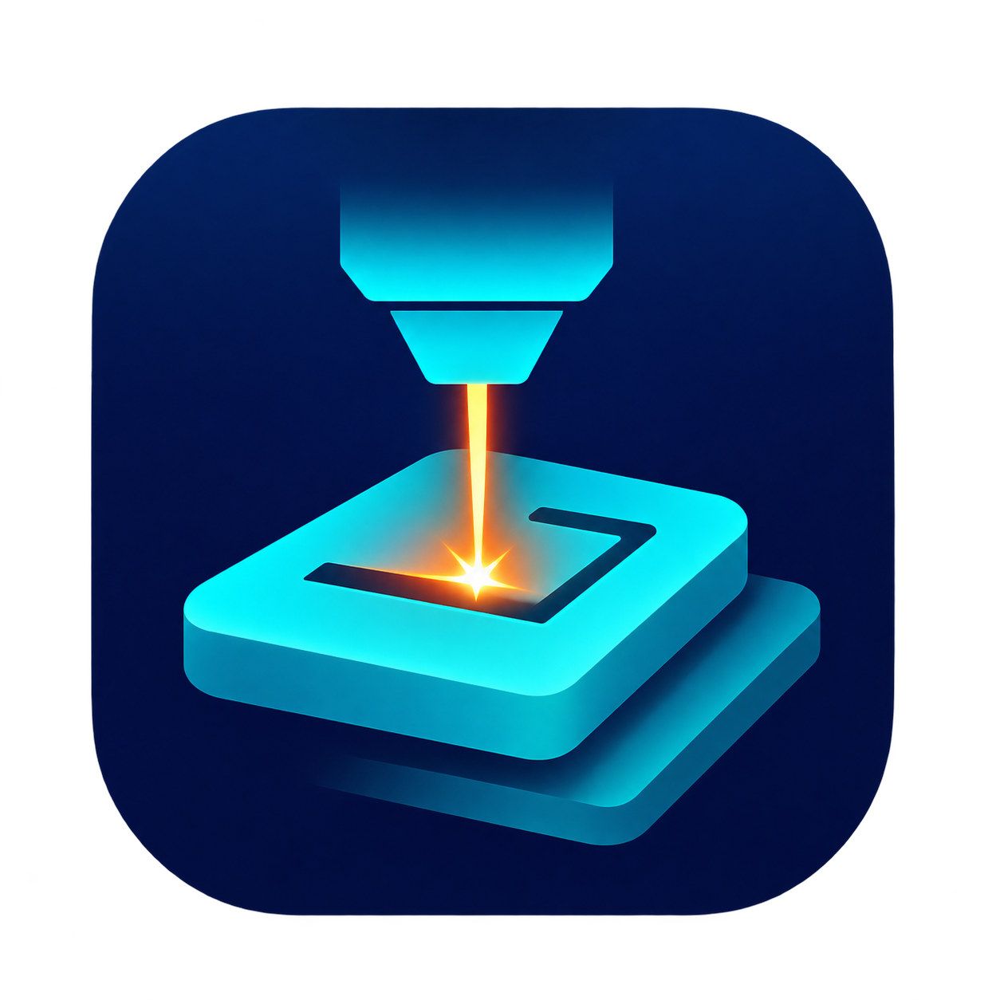
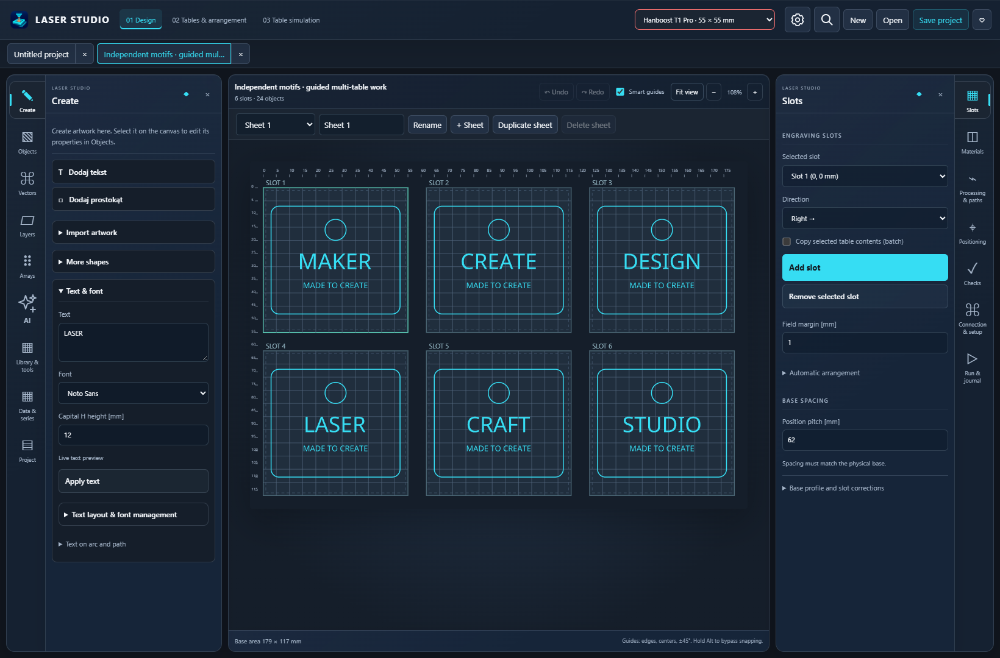
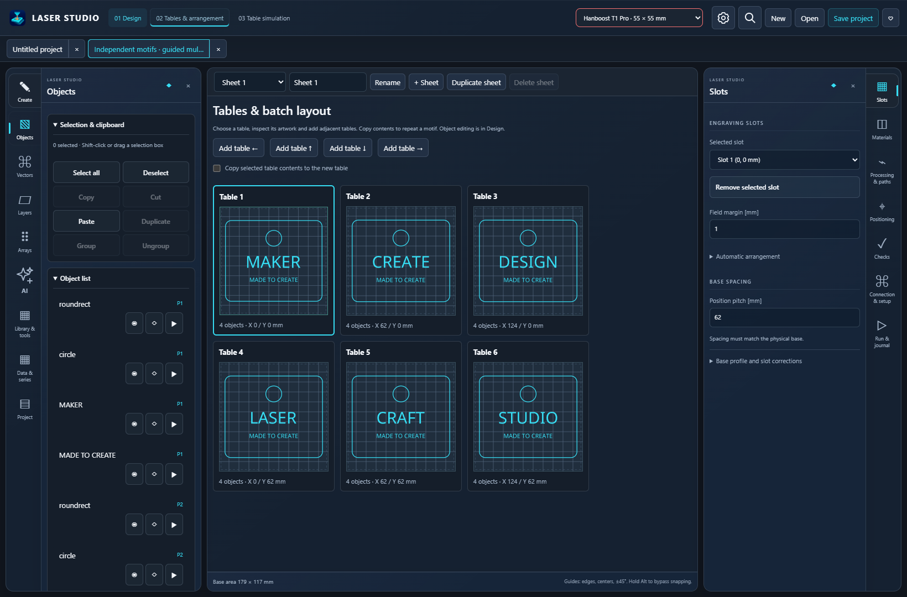
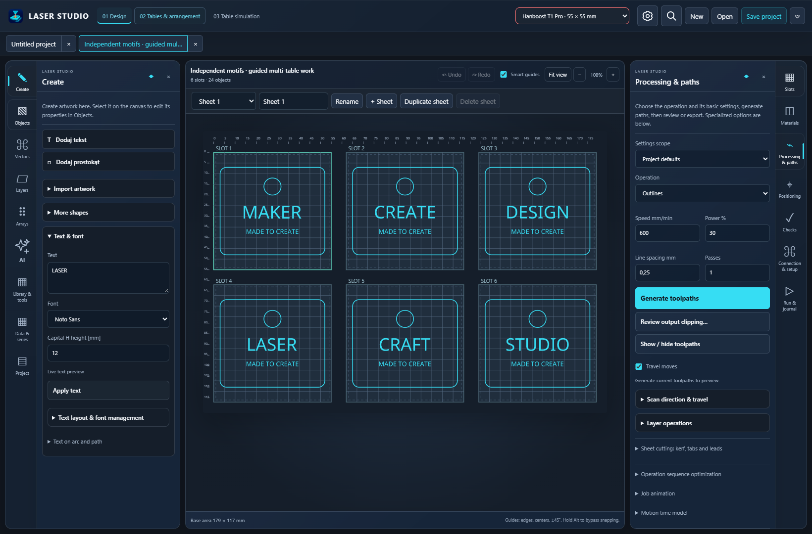
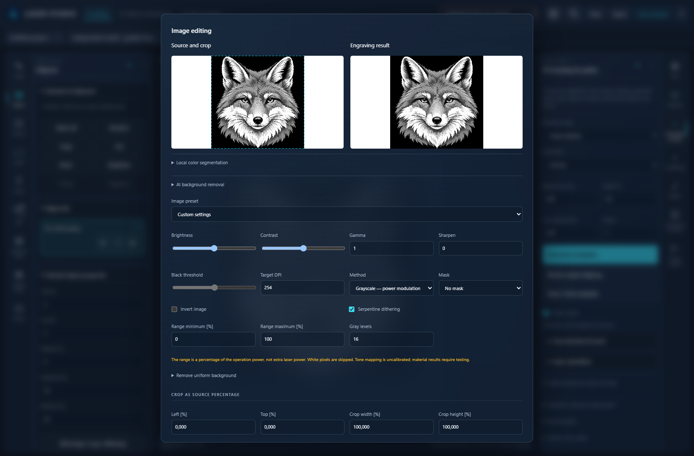

<h1 align="center">Laser Studio</h1>

<strong>Design a single piece. Prepare a whole series.</strong>

Laser engraving design, image preparation and guided multi-table work in one desktop workspace.

<a href="https://github.com/AlphaStudioDE/LaserStudio/releases/latest"><strong>Download for Windows and Linux</strong></a>

Laser Studio started with a practical idea: a small engraving area should still let you prepare a larger project. Begin with one table, add the next one in the direction you need, and give each table its own lettering, artwork or personalized item.

The application guides the sequence. Between tables, confirm where the machine or workpiece has been repositioned before continuing. You can cancel the remaining work at any step. Each area holds separate motifs; manually repositioned borders are not intended for seamless image stitching.

## Download

| Platform | Package |
|---|---|
| Windows x64 | [Setup.exe](https://github.com/AlphaStudioDE/LaserStudio/releases/download/v0.103.0/Laser-Studio-0.103.0-x64-Setup.exe) |
| Linux x86-64 | [AppImage](https://github.com/AlphaStudioDE/LaserStudio/releases/download/v0.103.0/Laser-Studio-0.103.0-x86_64.AppImage) |
| Debian / Ubuntu x64 | [DEB](https://github.com/AlphaStudioDE/LaserStudio/releases/download/v0.103.0/Laser-Studio-0.103.0-amd64.deb) |

[All releases and checksums](https://github.com/AlphaStudioDE/LaserStudio/releases). This repository hosts downloads and product information. The development repository is private.

## From one table to a production layout

- Start with one table and add more to the left, right, above or below.
- Copy a table for batch work or use different designs across the layout.
- Prepare personalized text and CSV-driven series.
- Review the order in the table simulation before working with the machine.
- Keep separate project sheets, save `.lsr` files and recover interrupted preparation.

## An editor built around the engraving

Live text previews, custom TTF/OTF fonts, multi-selection, grouping, rotation and alignment sit alongside smart guides for edges, centers and 45-degree directions. Add artwork, arrange whole motifs and preview the paths without leaving the workspace.

## Give images the preparation they need

Crop and tune raster artwork, work with grayscale power modulation or dithering, and review the result before applying changes. Local VTracer smooth-curve tracing is optional and has a preview before you commit. Vector imports, shape tools and text remain editable.

Optional Cloudflare Workers AI generation uses your own account. Local image editing and tracing do not require a cloud account.

The artwork above is a software preview. It is not a photograph or a guarantee of the result on a material.

## Standalone and FreedomSlicer

Laser Studio has a standalone Electron desktop application and a full FreedomSlicer workspace module sharing the same engine. The module replaces the modeling workspace while active and keeps the editor's own side panels and tools.

Device profiles include Hanboost T1 and T1 Pro 55 x 55 mm. Snapmaker Artisan Premium 40W has an experimental 400 x 400 mm/SACP implementation. Artisan hardware compatibility is not yet confirmed; it still needs qualification on an actual machine. Its 40W workflow uses manual start on the machine screen.

Verify the origin, focus, controller configuration and material settings on your own equipment. Startup does not automatically connect or begin a job.

## Support development

Laser Studio is free to download and use. The application includes an optional project-support window for voluntary contributions.

Built by Damian Borkowski. Original application code and branding are proprietary; third-party components retain their licenses. See [license](LICENSE.txt).
