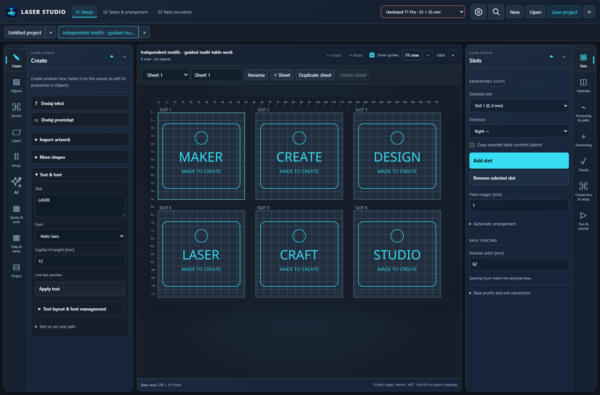
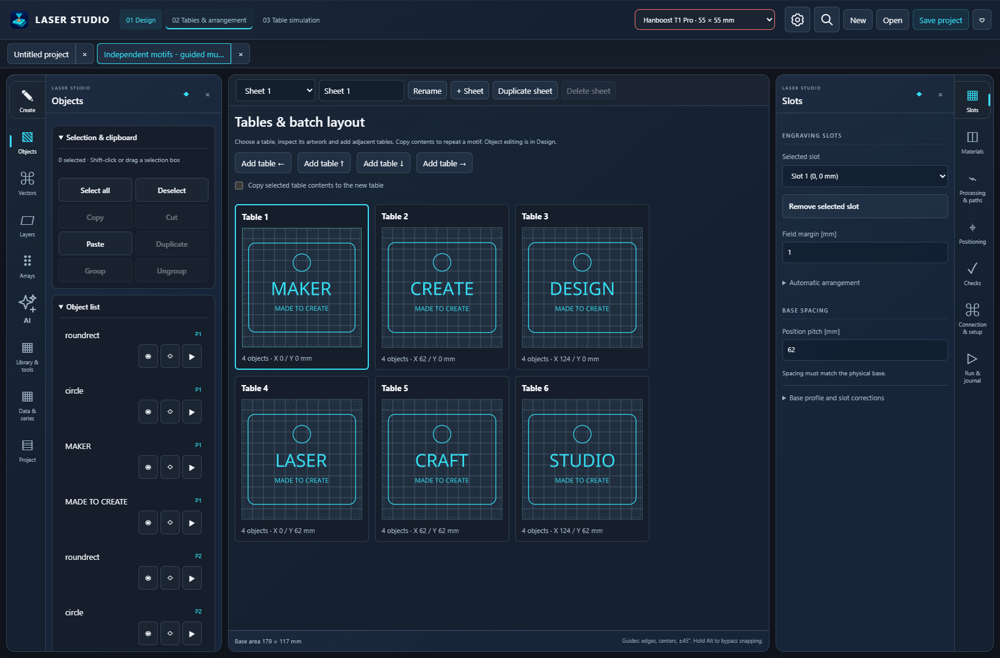
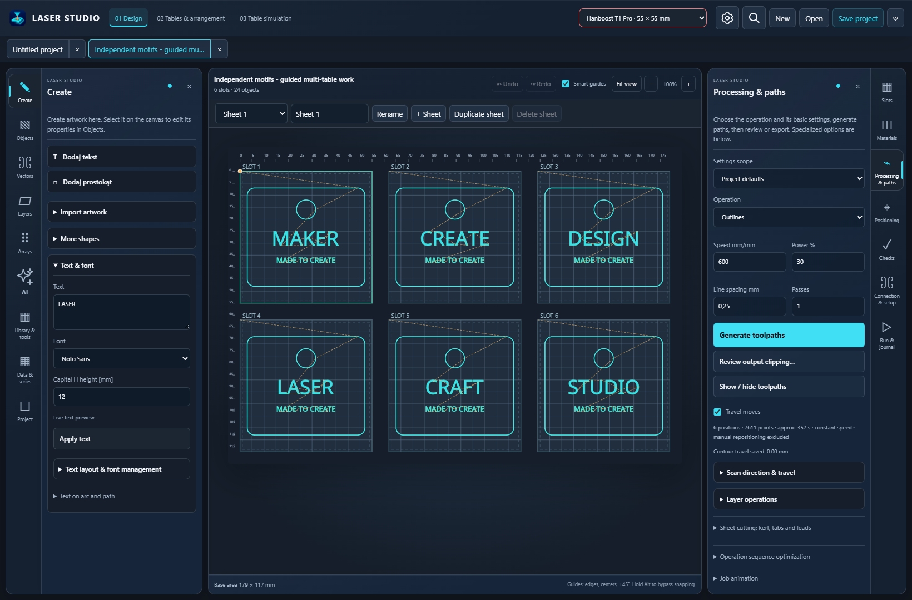
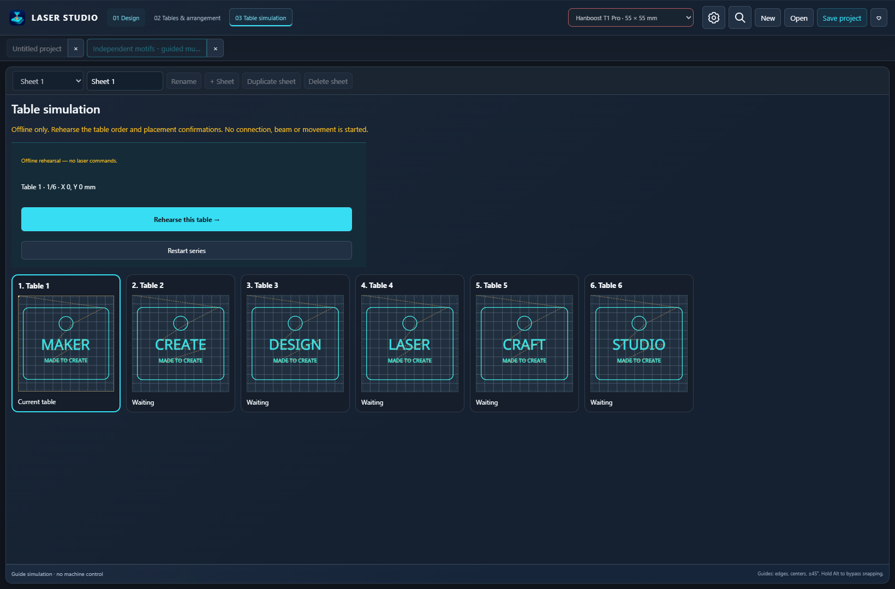
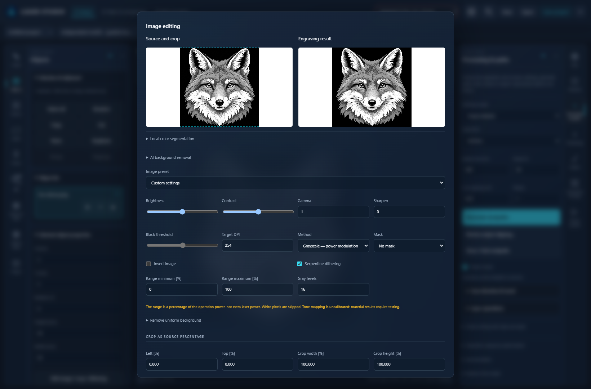

# Laser Studio for FreedomSlicer

A dedicated laser engraving workspace, from one piece to a whole series.

Design a single work area, add neighbouring tables, or duplicate a design for batch work. Table simulation explains the processing order and manual repositioning between jobs. Separate designs can use multiple tables without promising seamless joins across table boundaries.

- Text with local TTF/OTF fonts, live layout, alignment and smart guides.
- Image import, grayscale power modulation and optional local smooth-curve tracing.
- Generated toolpath previews and table-by-table simulation.
- USB integration through the required Laser Studio desktop companion.

The editor replaces FreedomSlicer's modelling viewport and presents its own workspace controls. It shares the engraving engine with standalone Laser Studio.

## Requirements and verification

This browser module requires the separately approved `laser-studio.desktop-platform` desktop companion, version 0.103.1. Installing this archive alone does not enable USB, local image processing or protected credentials. It is not a standalone FreedomSlicer Lite or phone application.

Hanboost T1 and T1 Pro profiles are available. Snapmaker Artisan support is experimental and has not been confirmed on physical Artisan hardware. A successful software build is not physical compatibility certification.

Review the selected machine, work origin, bounds and toolpath before operation. Installation does not start engraving or move hardware.

## Screenshots

